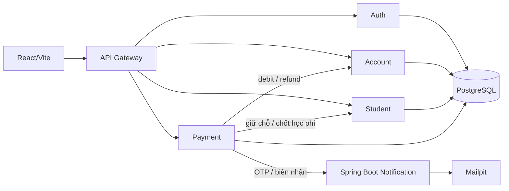
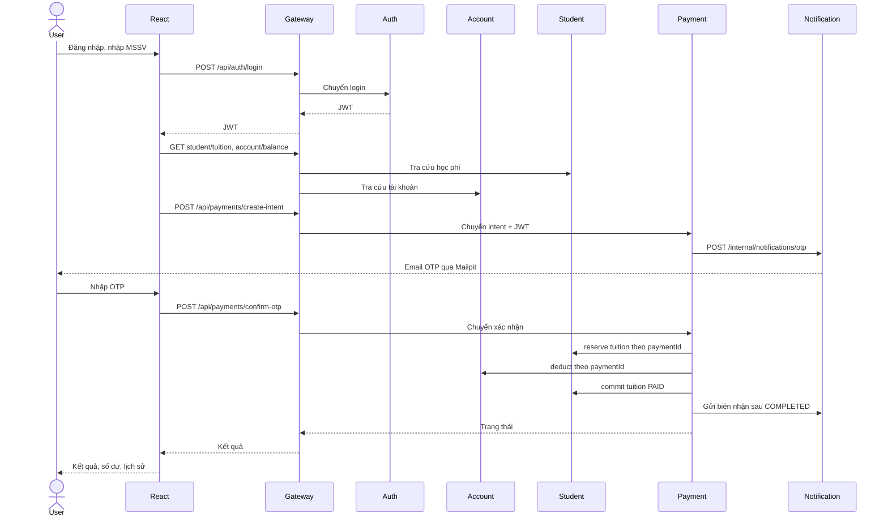

# iBanking Tuition Payment System

**Đồ án giữa kỳ Service-Oriented Architecture (SOA) – CS504070 · Trường Đại học Tôn Đức Thắng (TDTU)**

Ứng dụng mô phỏng thanh toán **toàn bộ** học phí qua iBanking. Người dùng đăng nhập tài khoản ngân hàng, tra cứu sinh viên bằng MSSV (có thể là chính mình hoặc người khác), xem học phí chưa thanh toán, xác nhận giao dịch bằng OTP email và theo dõi số dư, trạng thái, lịch sử. Hệ thống phục vụ học tập và trình diễn; không chuyển tiền thật.

## Mục lục

- [Thành viên và phân công](#thành-viên-và-phân-công)
- [Chức năng và công nghệ](#chức-năng-và-công-nghệ)
- [Địa chỉ truy cập](#địa-chỉ-truy-cập-sau-khi-khởi-động)
- [Kiến trúc và trách nhiệm](#kiến-trúc-và-trách-nhiệm)
- [Cấu trúc dự án và thiết kế dữ liệu](#cấu-trúc-dự-án-và-thiết-kế-dữ-liệu)
- [Yêu cầu và cấu hình môi trường](#yêu-cầu-và-cấu-hình-môi-trường)
- [Chạy bằng Docker Compose hoặc local](#chạy-bằng-docker-compose-hoặc-local)
- [API qua Gateway](#api-qua-gateway)
- [Quy trình thanh toán và tính nhất quán](#quy-trình-thanh-toán-và-tính-nhất-quán)
- [Hướng dẫn demo](#hướng-dẫn-demo)
- [Đặt lại mật khẩu tài khoản demo](#đặt-lại-mật-khẩu-tài-khoản-demo)
- [Build và kiểm thử](#build-và-kiểm-thử)
- [Giao diện, tài liệu và tình trạng dự án](#giao-diện-tài-liệu-và-tình-trạng-dự-án)
- [Bảo mật và giới hạn hiện tại](#bảo-mật-và-giới-hạn-hiện-tại)

## Thành viên và phân công

| Thành viên | Vai trò | Thành phần trong repo | Nhiệm vụ chính |
| --- | --- | --- | --- |
| Lê Đỗ Minh Thành | Backend Core & Security | `src/auth-service/`, `src/account-service/`, `src/api-gateway/`, `src/shared/` | Login, JWT, Gateway, quyền truy cập, xử lý số dư và đồng thời ở Account |
| Phan Đình Phước | Payment & Database | `src/student-service/`, `src/payment-service/`, `prisma/`, `sql/` | Student/Tuition, thanh toán, OTP, transaction, recovery và kiểm soát thanh toán trùng |
| Võ Tấn Tài | Frontend & Notification | `frontend/`, `notification-service/` | React UI/UX, tích hợp API, email OTP/biên nhận và demo |

Bảng phản ánh phân công nhóm và thành phần hiện có; Git history không được dùng để quy kết tác giả của từng dòng code.

## Chức năng và công nghệ

**API thật đã triển khai:** đăng nhập username/password, JWT, hồ sơ và số dư tài khoản, tra cứu sinh viên/học phí, tạo intent thanh toán toàn bộ, OTP email, debit/refund, cập nhật PAID, lịch sử và biên nhận. Có cơ chế idempotency, khóa dòng, retry và đối soát khi kết quả giữa các service chưa rõ. Người dùng có thể thanh toán học phí của MSSV khác; debit luôn từ tài khoản đã đăng nhập.

**Chế độ mock:** `frontend/mock/` cung cấp API và dữ liệu trong bộ nhớ để xem UI độc lập. Các hành vi mock như gửi lại OTP không chứng minh API thật hỗ trợ cùng hành vi. **Chưa xác minh:** kiểm thử thao tác và bố cục toàn bộ UI trực tiếp trên trình duyệt desktop/mobile; xem [báo cáo QA](docs/FULL_SYSTEM_TEST_REPORT.md).

| Layer | Technology | Purpose |
| --- | --- | --- |
| Frontend | React 19, TypeScript, Vite 7, Tailwind CSS 4, React Router, Axios | Giao diện và gọi Gateway |
| Backend services và Gateway | Node.js, TypeScript, Express, Prisma Client | Năm tiến trình HTTP độc lập; bốn service dữ liệu và một Gateway |
| Database | PostgreSQL 16 trong Compose, Prisma schema, SQL | Dữ liệu nghiệp vụ, transaction, constraint và role theo service |
| Authentication | scrypt có salt; JWT HS256, hạn 15 phút | Đăng nhập và định danh request |
| Notification | Java 17, Spring Boot 3.5.16, Spring Mail | Gửi OTP và biên nhận qua SMTP Mailpit hoặc nhà cung cấp thật |
| Deployment/demo | Dockerfile, Docker Compose, Mailpit | Chạy service và hộp thư thử nghiệm local |
| Testing | Node test runner, Vitest/Testing Library, JUnit, Mailpit | Unit, API, E2E, concurrency và email |
| Developer tools | npm scripts, Maven Wrapper, Swagger UI/OpenAPI | Build, test và xem contract |

## Địa chỉ truy cập sau khi khởi động

Các địa chỉ dưới đây dùng **cổng mặc định trong file mẫu**; nếu bạn đổi cổng trong `.env`, thay bằng giá trị tương ứng. Frontend phải chạy với `VITE_DEMO_MODE=false` khi trình diễn backend thật.

| Thành phần | URL mặc định |
| --- | --- |
| Frontend | [http://127.0.0.1:5173/](http://127.0.0.1:5173/) |
| Gateway health | [http://127.0.0.1:4000/health](http://127.0.0.1:4000/health) |
| Swagger Gateway | [http://127.0.0.1:4000/docs/](http://127.0.0.1:4000/docs/) |
| Mailpit (email OTP và biên nhận) | [http://127.0.0.1:8025/](http://127.0.0.1:8025/) |

Đây là URL **local**, chỉ hoạt động sau khi bạn đã làm các bước cấu hình và khởi động bên dưới. Không dùng địa chỉ của một máy QA khác để kiểm tra bản clone mới.
## Kiến trúc và trách nhiệm



| Thành phần | Công nghệ và trách nhiệm | Cổng nội bộ |
| --- | --- | --- |
| Frontend | React, TypeScript, Vite; Login, Dashboard, Payment, OTP, Result, History | 5173 trên host |
| API Gateway | Express; JWT, CORS, định tuyến allowlist; không truy cập DB | 4000 |
| Auth | Express; username/password, JWT, hồ sơ | 4004 |
| Account | Express; số dư, lịch sử, debit/refund idempotent | 4003 |
| Student | Express; MSSV, học phí, giữ chỗ và chốt PAID | 4001 |
| Payment | Express; intent, OTP, trạng thái, recovery, biên nhận | 4002 |
| Notification | Spring Boot; gửi OTP và biên nhận qua Mailpit hoặc SMTP thật | 8085 |
| PostgreSQL | Một server/schema, bốn role giới hạn theo bảng service | 5432 trong Docker |
| Mailpit | Hộp thư và SMTP thử nghiệm | 8025/1025 trong Docker |

Auth, Account, Student và Payment là **bốn process riêng**, mỗi process dùng một PostgreSQL role chỉ có quyền trên bảng mình sở hữu. Gateway là cổng HTTP công khai duy nhất của backend khi chạy bằng `compose.microservices.yml`. Các route nội bộ như debit/refund, giữ chỗ và commit học phí không được Gateway công bố.

```text
frontend/                  React app, mock API và component tests
src/api-gateway/           Gateway
src/auth-service/          Auth
src/account-service/       Account và ledger debit/refund
src/student-service/       Student và tuition
src/payment-service/       Payment, OTP và recovery
src/shared/                HTTP, JWT và tiện ích dùng chung
notification-service/      Spring Boot, template email, JUnit
prisma/                    Schema, seed, cấp role
sql/                       CHECK, unique index và recovery SQL
tests/                     Core, E2E và process tests
docs/                      Contract, Postman, báo cáo kiểm thử
```

## Cấu trúc dự án và thiết kế dữ liệu

Cây trên chỉ liệt kê thư mục nguồn chính. Ở gốc repo còn có `package.json`, `Dockerfile`, `docker-compose.yml`, `compose.integration.yml`, `compose.microservices.yml`, `.env.example` và `postman_collection.json`. `specs/001-payment-student-service/` chứa đặc tả Payment/Student. Không đưa thư mục build vào sơ đồ.

PostgreSQL dùng database `ibanking_db` trong Compose. URL kết nối chọn schema riêng bằng tham số `?schema=micro_*`. [Prisma schema](prisma/schema.prisma) định nghĩa bảy bảng:

| Service sở hữu | Bảng | Quan hệ và dữ liệu chính |
| --- | --- | --- |
| Auth | `users` | Username duy nhất, password hash, email; `accounts.user_id` liên kết logic với user (không khai báo Prisma relation) |
| Account | `accounts`, `account_debits` | Một account cho một user; debit ledger theo `payment_id` duy nhất và FK tới account |
| Student | `students`, `tuition_fees` | Một student có nhiều tuition; duy nhất `(student_id, semester)`, trạng thái UNPAID/PAID |
| Payment | `payments`, `otp_codes` | Payment lưu account/student/tuition ID dạng tham chiếu xuyên service; OTP có FK tới payment |

Bốn service có PostgreSQL role riêng, chỉ được cấp quyền bảng mình sở hữu bằng [`prisma/provision-micro-roles.ts`](prisma/provision-micro-roles.ts). Chúng vẫn dùng **chung một PostgreSQL server và schema**; không phải bốn database tách biệt. `prisma db push` tạo/cập nhật bảng trên schema mới; [`sql/account-schema.sql`](sql/account-schema.sql) thêm CHECK số dư, [`sql/payment-recovery.sql`](sql/payment-recovery.sql) thêm constraint/index hỗ trợ recovery và chống nhiều payment COMPLETED cho cùng học phí. Repo không có thư mục Prisma migration versioned; không dùng `db:push` làm kế hoạch migrate production.

## Yêu cầu và cấu hình môi trường

### Phần mềm cần có

- [Git](https://git-scm.com/install/) để clone repository.
- [Node.js](https://nodejs.org/en/download/) kèm npm để chạy Prisma và frontend trên host. Dockerfile backend dùng Node **22**; Vite 7 trong frontend cần Node **22.12+** hoặc **24+**. Repo không khóa npm version.
- [Docker Desktop cho Windows](https://docs.docker.com/desktop/setup/install/windows-install/) với Linux containers và Docker Compose để chạy PostgreSQL, Mailpit, Notification và năm service Node theo Option A. Compose dùng PostgreSQL **16-alpine**. Không cần cài PostgreSQL riêng nếu dùng Compose.
- Chỉ khi chạy Notification/JUnit **ngoài Docker**: [JDK 17+](https://adoptium.net/temurin/releases/?version=17). Repo có Maven Wrapper; không cần cài Maven riêng. Máy dùng JDK 11 mặc định sẽ không build được Notification.
- OTP demo gửi tới **Mailpit local** qua SMTP trong Compose; không cần tài khoản email thật hoặc SMTP bên ngoài.

Các lệnh bên dưới đã được kiểm tra trong **Windows PowerShell**. Docker Compose có file cấu hình đa nền tảng, nhưng startup trên macOS/Linux chưa được xác minh trong audit này; dùng `cp` thay `Copy-Item`, `npm` thay `npm.cmd` và `./mvnw` thay `.\mvnw.cmd` nếu tự chạy trên các hệ đó.

### Biến môi trường quan trọng

| Nhóm | Biến | Công dụng |
| --- | --- | --- |
| Database | `POSTGRES_PASSWORD`, `POSTGRES_PORT`, `DATABASE_URL` | PostgreSQL container, cổng host và URL admin với schema `micro_*` |
| Quyền DB | `AUTH_DATABASE_URL`, `ACCOUNT_DATABASE_URL`, `STUDENT_DATABASE_URL`, `PAYMENT_DATABASE_URL` | URL role do `db:roles` sinh, dùng riêng cho bốn service |
| Secrets | `JWT_SECRET`, `OTP_SECRET`, `AUTH_SERVICE_TOKEN`, `ACCOUNT_SERVICE_TOKEN`, `STUDENT_SERVICE_TOKEN`, `NOTIFICATION_INTERNAL_KEY` | Ký token/OTP và xác thực nội bộ; cấp giá trị ngẫu nhiên khác nhau |
| Demo | `DEMO_PASSWORD`, `DEMO_EMAIL` | Seed user và địa chỉ nhận OTP trong Mailpit |
| Host HTTP | `GATEWAY_PORT`, `NOTIFICATION_PORT`, `MAILPIT_HTTP_PORT`, `MAILPIT_SMTP_PORT`, `FRONTEND_ORIGIN` | Cổng publish và origin CORS |
| Kết nối | `AUTH_SERVICE_ORIGIN`, `ACCOUNT_SERVICE_ORIGIN`, `STUDENT_SERVICE_ORIGIN`, `PAYMENT_SERVICE_ORIGIN`, `NOTIFICATION_SERVICE_URL`, `MAILPIT_ORIGIN` | Địa chỉ service cho tiến trình chạy trên host và bài test |
| Frontend | `VITE_DEMO_MODE`, `VITE_API_BASE_URL`, `VITE_API_CONTRACT_CONFIRMED` | Chọn mock/API thật và địa chỉ Gateway `/api` |
| SMTP local | `SMTP_HOST`, `SMTP_PORT`, `SMTP_USERNAME`, `SMTP_PASSWORD`, `SMTP_AUTH`, `SMTP_STARTTLS`, `MAIL_FROM` | Cấu hình Notification khi không dùng mặc định Mailpit trong Compose |
| SMTP thật | `NOTIFICATION_SMTP_HOST`, `NOTIFICATION_SMTP_PORT`, `NOTIFICATION_SMTP_USERNAME`, `NOTIFICATION_SMTP_PASSWORD`, `NOTIFICATION_SMTP_AUTH`, `NOTIFICATION_SMTP_STARTTLS`, `NOTIFICATION_SMTP_SSL`, `NOTIFICATION_MAIL_FROM` | Chỉ dùng với `compose.smtp.yml`; credential giữ ngoài Git |

Xem [.env.example](.env.example), [frontend/.env.example](frontend/.env.example) và [application.yml](notification-service/src/main/resources/application.yml). Compose cấu hình Notification gửi qua Mailpit, nên không cần tài khoản SMTP thật. `SMTP_HOST/PORT/USER/PASS` ở `.env` là fallback của Payment khi không dùng Notification; `SMTP_USERNAME/PASSWORD/AUTH/STARTTLS/MAIL_FROM` là cấu hình Spring Mail khi chạy Notification ngoài Compose. Không đưa secret vào `VITE_*` hoặc Git.

## Chạy bằng Docker Compose hoặc local

### Option A — Docker Compose và frontend trên host

#### 1. Clone và kiểm tra môi trường

Mở PowerShell ở thư mục bạn muốn đặt dự án. Nếu đã có checkout đúng branch, bỏ qua `git clone` và chuyển vào thư mục repo.

```powershell
git clone --single-branch --branch fix/microservices-architecture https://github.com/tactra2019-dot/IBanking-Tuition-.git Midterm_SOA
Set-Location .\Midterm_SOA
git branch --show-current
node --version
npm.cmd --version
docker compose version
```

Khởi động Docker Desktop trước khi chạy Compose. **Chỉ dùng database phát triển/test riêng.** Các lệnh `db:push` và seed dưới đây dành cho schema mới có tên bắt đầu bằng `micro_`. E2E và core DB test chỉ chấp nhận schema `micro_test_*`. Đừng áp schema mới lên dữ liệu demo cũ hoặc production.

#### 2. Tạo cấu hình local

Từ thư mục gốc repo:

```powershell
Copy-Item .env.example .env
Copy-Item frontend/.env.example frontend/.env
```

Sửa `.env` bằng editor. Các giá trị bắt buộc:

| Biến | Cách đặt |
| --- | --- |
| `POSTGRES_PASSWORD` | Mật khẩu ngẫu nhiên cho PostgreSQL container mới |
| `POSTGRES_PORT` | Cổng host còn trống, ví dụ `5434` |
| `DATABASE_URL` | URL admin có **cùng mật khẩu/cổng** và schema mới, ví dụ `micro_demo_nhom10` |
| `JWT_SECRET`, `ACCOUNT_SERVICE_TOKEN`, `AUTH_SERVICE_TOKEN`, `STUDENT_SERVICE_TOKEN` | Bốn khóa **khác nhau**, mỗi khóa tối thiểu 32 byte |
| `OTP_SECRET`, `NOTIFICATION_INTERNAL_KEY` | Hai khóa khác nhau, mỗi khóa tối thiểu 32 byte |
| `DEMO_PASSWORD` | Mật khẩu demo tối thiểu 12 ký tự; đặt trước khi seed account |
| `DEMO_EMAIL` | Địa chỉ thử nghiệm để tìm thư trong Mailpit, ví dụ `demo1@ibanking.test` |
| `FRONTEND_ORIGIN` | Đúng origin Vite: `http://127.0.0.1:5173` |
| `GATEWAY_PORT`, `NOTIFICATION_PORT`, `MAILPIT_HTTP_PORT`, `MAILPIT_SMTP_PORT` | Cổng host tùy chọn; mặc định 4000, 8085, 8025, 1025 |

Ví dụ nếu cổng cũ đang bận: `POSTGRES_PORT=5434`, `GATEWAY_PORT=4010`, `NOTIFICATION_PORT=8086`, `MAILPIT_HTTP_PORT=8026`, `MAILPIT_SMTP_PORT=1026`. Khi đó đặt `NOTIFICATION_SERVICE_URL=http://127.0.0.1:8086/internal/notifications` và `MAILPIT_ORIGIN=http://127.0.0.1:8026` cho các bài test chạy trên host. `DATABASE_URL` sẽ có dạng `postgresql://postgres:<mật-khẩu>@127.0.0.1:5434/ibanking_db?schema=micro_demo_nhom10`. Dùng mật khẩu dạng hex để không phải URL-encode ký tự đặc biệt.

Tạo từng khóa ngẫu nhiên rồi dán vào `.env`:

```powershell
node -e "console.log(require('node:crypto').randomBytes(32).toString('hex'))"
```

Không đặt JWT, OTP, service token hay mật khẩu DB vào biến `VITE_*`; các biến này được đóng gói vào frontend. File `.env` và `.env.*.local` đã được Git ignore, nhưng vẫn cần kiểm tra `git status` trước khi chia sẻ code.

#### 3. PostgreSQL, Notification và database

Chọn một tên project Compose riêng. Ví dụ `ibanking-demo`:

```powershell
$project = 'ibanking-demo'
docker compose -p $project --env-file .env -f docker-compose.yml -f compose.integration.yml up -d --build --wait postgres mailpit notification
npm.cmd ci
npm.cmd run db:generate
npm.cmd run db:push -- --skip-generate
npm.cmd run db:account
npm.cmd run db:recovery
npm.cmd run db:roles
```

`db:account` thêm CHECK số dư, `db:recovery` thêm các cấu trúc phục hồi và unique index chống hai payment COMPLETED cho cùng học phí. `db:roles` chỉ chạy **một lần** trên schema mới và tạo file `.env.micro-roles.local` chứa bốn URL role. File này đã được Git ignore; không đưa lên GitHub.

Thay bốn dòng `AUTH_DATABASE_URL`, `ACCOUNT_DATABASE_URL`, `STUDENT_DATABASE_URL` và `PAYMENT_DATABASE_URL` trong `.env` bằng URL vừa sinh. Có thể làm tự động mà không in mật khẩu ra terminal:

```powershell
$roles = @{}
Get-Content .env.micro-roles.local | ForEach-Object {
  $name, $value = $_ -split '=', 2
  $roles[$name] = $value
}
$config = Get-Content .env
$config = foreach ($line in $config) {
  $name = ($line -split '=', 2)[0]
  if ($roles.ContainsKey($name)) { "$name=$($roles[$name])" } else { $line }
}
$config | Set-Content .env
npm.cmd run seed:account
npm.cmd run seed:integration
npm.cmd run build
```

`seed:account` tạo `demo1`/`demo2`; `seed:integration` tạo ba MSSV `521H9001`–`521H9003`. Seed account **không đổi mật khẩu** của user đã tồn tại. Nếu đổi `DEMO_PASSWORD` sau lần seed đầu, tài khoản cũ vẫn dùng mật khẩu ban đầu. Không chạy script `npm run seed` cũ trên database demo đang sử dụng.

#### 4. Chạy năm service Node bằng Docker Compose

Bốn role URL trong `.env` dùng địa chỉ PostgreSQL **trên host** để test bằng Node. Container cần hostname `postgres`, port `5432`. Tạo file Compose local từ `.env`:

```powershell
$portLine = Get-Content .env | Where-Object { $_ -like 'POSTGRES_PORT=*' } | Select-Object -First 1
$port = ($portLine -split '=', 2)[1]
$composeConfig = foreach ($line in Get-Content .env) {
  if ($line -match '^(AUTH|ACCOUNT|STUDENT|PAYMENT)_DATABASE_URL=') {
    $line.Replace("@127.0.0.1:$port/", '@postgres:5432/').Replace("@localhost:$port/", '@postgres:5432/')
  } else { $line }
}
$composeConfig | Set-Content .env.compose.local
docker compose -p $project --env-file .env.compose.local -f docker-compose.yml -f compose.integration.yml -f compose.microservices.yml config -q
docker compose -p $project --env-file .env.compose.local -f docker-compose.yml -f compose.integration.yml -f compose.microservices.yml up -d --build --wait
```

`config -q` phải thoát mã 0. `up --wait` phải báo tất cả container healthy. File `.env.compose.local` đã được Git ignore. Nếu Compose đã chạy với cấu hình cũ, không đổi mật khẩu/volume hiện có tùy tiện; tạo project và cổng mới.

#### 5. Chạy frontend dùng API thật

Sửa `frontend/.env`:

```dotenv
VITE_DEMO_MODE=false
VITE_API_CONTRACT_CONFIRMED=true
VITE_API_BASE_URL=http://127.0.0.1:4000/api
```

Đổi `4000` thành `GATEWAY_PORT` thực tế (ví dụ `4010` nếu cổng mặc định đang bận). `FRONTEND_ORIGIN` trong `.env` phải là `http://127.0.0.1:5173`. Trong một terminal riêng:

```powershell
npm.cmd ci --prefix frontend
npm.cmd run dev:ui --prefix frontend
```

Mở `http://127.0.0.1:5173/`. Gateway trả Bearer JWT sau login; frontend giữ token trong RAM, nên reload trang sẽ cần đăng nhập lại. Tài khoản `demo1` dùng mật khẩu `DEMO_PASSWORD` đã seed. Frontend **chỉ** gọi Gateway; đường dẫn API không phải port Notification.

### Chế độ frontend mock

Để xem UI độc lập với backend, đặt `VITE_DEMO_MODE=true` trong `frontend/.env` rồi chạy `npm.cmd run dev --prefix frontend`. Script này khởi động Vite và mock API; dữ liệu lưu trong RAM, OTP mock khác với OTP Mailpit và **không chứng minh backend thật hoạt động**. Không chạy đồng thời `dev` và `dev:ui` trên cùng cổng 5173.

### Gửi email thật qua Gmail (tùy chọn)

Compose mặc định dùng Mailpit để kiểm thử. Để **không chạy Mailpit** và gửi OTP/biên nhận qua Gmail, dùng `compose.smtp.yml` thay cho `compose.integration.yml`. Tài khoản Gmail gửi thư cần bật xác minh hai bước và tạo [App Password theo hướng dẫn Google](https://support.google.com/accounts/answer/185833); **không dùng mật khẩu đăng nhập Gmail thông thường**. Google công bố SMTP `smtp.gmail.com`, port **587/STARTTLS** trong [hướng dẫn SMTP](https://support.google.com/mail/answer/7104828).

Trong `.env.compose.local` (file Git ignore), đặt `NOTIFICATION_SMTP_HOST=smtp.gmail.com`, `NOTIFICATION_SMTP_PORT=587`, `NOTIFICATION_SMTP_USERNAME=<email-gửi>`, `NOTIFICATION_MAIL_FROM=<email-gửi>`, `NOTIFICATION_SMTP_AUTH=true`, `NOTIFICATION_SMTP_STARTTLS=true` và `NOTIFICATION_SMTP_SSL=false`. Để `NOTIFICATION_SMTP_PASSWORD=` trống trong file và nhập App Password khi chạy, tránh lưu mật khẩu vào repository. Địa chỉ nhận OTP lấy từ `users.email` của tài khoản đang đăng nhập: đặt `DEMO_EMAIL=<email-nhận-thật>` **trước lần seed đầu**. Sửa `DEMO_EMAIL` sau khi seed không đổi email của user cũ; cần cập nhật bản ghi demo bằng công cụ quản trị hoặc tạo schema demo mới.

Từ thư mục gốc repo, sau khi đã tạo database, role và `.env.compose.local` như Option A:

```powershell
$project = 'ibanking-demo'
$secure = Read-Host 'Gmail App Password' -AsSecureString
$ptr = [Runtime.InteropServices.Marshal]::SecureStringToBSTR($secure)
try {
  $env:NOTIFICATION_SMTP_PASSWORD = [Runtime.InteropServices.Marshal]::PtrToStringBSTR($ptr)
  docker compose -p $project --env-file .env.compose.local -f docker-compose.yml -f compose.smtp.yml -f compose.microservices.yml config -q
  docker compose -p $project --env-file .env.compose.local -f docker-compose.yml -f compose.smtp.yml -f compose.microservices.yml up -d --build --wait --remove-orphans
} finally {
  [Runtime.InteropServices.Marshal]::ZeroFreeBSTR($ptr)
  Remove-Item Env:NOTIFICATION_SMTP_PASSWORD -ErrorAction SilentlyContinue
}
```

Khi chuyển từ project Compose Mailpit cùng tên, `--remove-orphans` dừng/xóa container Mailpit; dữ liệu PostgreSQL volume được giữ. Cần nhập lại App Password khi tạo lại/recreate Notification container. Chỉ dùng email thử nghiệm do bạn kiểm soát; bộ `test:e2e` đọc OTP từ Mailpit nên **không chạy bộ test đó ở chế độ Gmail thật**. Nếu gửi OTP lỗi, Payment không được debit; lỗi biên nhận sau COMPLETED được retry, không đảo giao dịch đã hoàn tất.
### Quản lý Compose

Sau khi cấu hình ở các bước trên, kiểm tra và xem log bằng:

```powershell
docker compose -p $project --env-file .env.compose.local -f docker-compose.yml -f compose.integration.yml -f compose.microservices.yml ps
docker compose -p $project --env-file .env.compose.local -f docker-compose.yml -f compose.integration.yml -f compose.microservices.yml logs --tail=100 gateway payment notification
docker compose -p $project --env-file .env.compose.local -f docker-compose.yml -f compose.integration.yml -f compose.microservices.yml down
```

`down` dừng/xóa container và network của project; không thêm `-v` nếu muốn giữ volume PostgreSQL. Dừng Vite bằng `Ctrl+C` ở terminal của nó.

### Option B — Chạy các service local

Sao chép và điền `.env`/`frontend/.env` theo bước cấu hình ở Option A. Chỉ chạy PostgreSQL và Mailpit bằng Compose; **không chạy đồng thời** container Notification/Node của Option A trên cùng các cổng. Bốn URL role trong `.env` phải dùng `127.0.0.1:POSTGRES_PORT`; các service origin dùng địa chỉ host trong `.env.example`.

```powershell
$project = 'ibanking-local'
docker compose -p $project --env-file .env -f docker-compose.yml -f compose.integration.yml up -d --wait postgres mailpit
npm.cmd ci
npm.cmd run db:generate
npm.cmd run db:push -- --skip-generate
npm.cmd run db:account
npm.cmd run db:recovery
npm.cmd run db:roles
# Sao chép bốn URL vừa sinh từ .env.micro-roles.local vào .env như Option A.
npm.cmd run seed:account
npm.cmd run seed:integration
npm.cmd run build
```

Mở terminal 1 để chạy Notification (đặt cùng `NOTIFICATION_INTERNAL_KEY` trong `.env` thành biến môi trường của terminal và `SMTP_PORT` theo Mailpit host port):

```powershell
$env:NOTIFICATION_INTERNAL_KEY = (Get-Content .env | Where-Object { $_ -like 'NOTIFICATION_INTERNAL_KEY=*' } | Select-Object -First 1).Split('=', 2)[1]
$env:SMTP_HOST = '127.0.0.1'
$env:SMTP_PORT = (Get-Content .env | Where-Object { $_ -like 'MAILPIT_SMTP_PORT=*' } | Select-Object -First 1).Split('=', 2)[1]
cd notification-service
.\mvnw.cmd spring-boot:run
```

Mở terminal 2 tại thư mục gốc repo: `npm.cmd run dev`. Script [`src/run-all.ts`](src/run-all.ts) khởi chạy **năm process riêng** từ `dist/`, đặt role DB riêng cho Auth/Account/Student/Payment; Gateway mặc định cổng 4000 (`PORT_GATEWAY` khi chạy local; `GATEWAY_PORT` chỉ áp dụng cho Compose). Sau khi sửa source, chạy `npm.cmd run build` và khởi động lại. Mở terminal 3: `npm.cmd ci --prefix frontend; npm.cmd run dev:ui --prefix frontend`, với `frontend/.env` ở chế độ API thật và `VITE_API_BASE_URL=http://127.0.0.1:4000/api`. Đóng từng terminal bằng `Ctrl+C`.

## API qua Gateway

Frontend gọi `VITE_API_BASE_URL` kết thúc bằng `/api`. Gateway chuyển nguyên method/path sang service tương ứng, không rewrite prefix. Các endpoint công khai sau lấy từ [`src/api-gateway/index.ts`](src/api-gateway/index.ts); cột xác thực là yêu cầu của Gateway:

| Service | HTTP Method | Endpoint | Description | Authentication Required |
| --- | --- | --- | --- | --- |
| Gateway | GET | `/health` | Health check | Không |
| Auth | POST | `/api/auth/login` | Username/password → JWT | Không |
| Auth | GET | `/api/auth/me` | Hồ sơ người dùng | Bearer JWT |
| Auth | POST | `/api/auth/email-change/request` | Kiểm tra mật khẩu và gửi mã tới email mới | Bearer JWT |
| Auth | POST | `/api/auth/email-change/confirm` | Xác minh mã và cập nhật email | Bearer JWT |
| Account | GET | `/api/accounts/me` | Tài khoản hiện tại | Bearer JWT |
| Account | GET | `/api/accounts/me/balance` | Số dư | Bearer JWT |
| Account | GET | `/api/accounts/me/transactions` | Lịch sử | Bearer JWT |
| Student | GET | `/api/students/:studentCode` | Tra MSSV | Bearer JWT |
| Student | GET | `/api/tuitions/student/:studentCode` | Học phí | Bearer JWT |
| Payment | POST | `/api/payments/create-intent` | Tạo intent; hỗ trợ `Idempotency-Key` | Bearer JWT |
| Payment | POST | `/api/payments/confirm-otp` | Xác thực OTP | Bearer JWT |
| Payment | GET | `/api/payments/:paymentId` | Chi tiết/trạng thái | Bearer JWT |
| Payment | GET | `/api/payments/account/:accountId` | Lịch sử theo account sở hữu | Bearer JWT |

API nội bộ **không được Gateway công bố**: Account `GET /api/accounts/:accountId`, `POST /api/accounts/deduct`, `POST /api/accounts/refund` dùng service token; Student `GET /internal/tuitions/:id`, `POST /internal/tuitions/:id/{reserve,commit,release}` dùng service token; Notification `POST /internal/notifications/otp`, `/email-change` và `/payment-success` dùng internal key. Chúng phục vụ điều phối, không gọi trực tiếp từ frontend.

### Đổi email nhận thông báo

Trong **Tài khoản của tôi**, nhập email mới và mật khẩu hiện tại, sau đó nhập mã 6 chữ số được gửi tới email mới. Mã hết hạn sau 5 phút, tối đa 5 lần nhập sai; yêu cầu mã mới cách nhau ít nhất 60 giây. Auth chỉ lưu email mới sau khi mã đúng. OTP và biên nhận của **giao dịch tạo sau khi đổi** gửi tới email mới; giao dịch đã tạo trước đó giữ địa chỉ người trả tiền đã ghi trong payment. Nếu đang dùng Mailpit, lấy mã xác minh trong Mailpit; nếu dùng Gmail SMTP, xem hộp thư email mới. Chế độ mock dùng mã `123456` và không gửi email thật.

Hai API dùng Bearer JWT: `POST /api/auth/email-change/request` nhận `{ "email": "new@example.com", "password": "..." }`; `POST /api/auth/email-change/confirm` nhận `{ "code": "123456" }`. Không ghi mã hoặc mật khẩu vào log. Với schema demo đã tạo trước khi có tính năng này, chạy `npm.cmd run db:account` một lần bằng `DATABASE_URL` quản trị đúng schema trước khi khởi động Auth mới để thêm các cột xác minh vào bảng `users`.

Gateway cho phép origin frontend và các header `Authorization`, `Content-Type`, `Idempotency-Key`. Xem Swagger Gateway tại `/docs/` và tài liệu [Auth/Account/Gateway](docs/tv1.md), [Payment–Account contract](docs/payment-account-contract.md), [OpenAPI Payment/Student](specs/001-payment-student-service/contracts/openapi.yaml).

## Quy trình thanh toán và tính nhất quán

1. User đăng nhập, xem số dư và tra học phí bằng MSSV. Payment kiểm tra số tiền toàn bộ, trạng thái học phí và số dư.
2. Payment tạo intent theo `Idempotency-Key`; OTP được lưu dạng HMAC, gắn với payment, có hạn **5 phút** và dùng một lần. Notification gửi OTP tới email demo trong Mailpit.
3. Student giữ chỗ khoản học phí theo paymentId. Account debit nguyên tử và ghi ledger theo paymentId để retry không trừ lần hai.
4. Student chỉ chuyển học phí sang PAID khi chốt đúng paymentId. Payment ghi COMPLETED, lịch sử và gửi biên nhận sau commit.
5. Khi mất phản hồi hoặc có lỗi giữa các service, worker đối soát trạng thái `PROCESSING`/`REFUND_PENDING`. Trường hợp chưa đủ bằng chứng được giữ `REVIEW_REQUIRED` để kiểm tra ledger và học phí, không tự kết luận thành công.



Account xử lý debit trong một PostgreSQL transaction ở isolation `ReadCommitted`: ledger `account_debits.payment_id` là khóa chính, `SELECT ... FOR UPDATE` khóa entry, `UPDATE accounts ... WHERE balance >= amount` không cho âm. Student khóa dòng `tuition_fees FOR UPDATE` trước reserve/commit/release. Payment có unique `(account_id, idempotency_key)` và index duy nhất cho payment COMPLETED theo học phí. OTP dùng HMAC, hạn 5 phút, tối đa 5 lần sai, cập nhật dùng một lần bằng điều kiện nguyên tử.

Không có distributed ACID transaction giữa bốn service. Payment ghi trạng thái bền trước HTTP call, dùng `paymentId` để retry debit/refund an toàn; HTTP lỗi không được hiểu là debit thất bại. Worker phục hồi tiếp tục reserve/debit/commit hoặc hoàn tiền và release nếu có bằng chứng lỗi. Sau giới hạn retry, `REVIEW_REQUIRED` yêu cầu đối soát thủ công. Biên nhận được gửi sau khi hoàn tất và có cờ `receipt_sent` để retry.

Frontend chỉ hiện thành công khi API trả trạng thái hoàn tất. API thật hiện không có chức năng gửi lại OTP trên cùng giao dịch; hãy tạo yêu cầu mới theo hướng dẫn trong UI. Đừng thử lại một giao dịch chưa rõ kết quả trước khi xem trạng thái/lịch sử.

## Hướng dẫn demo

1. Mở frontend; đăng nhập `demo1` hoặc `demo2` bằng `DEMO_PASSWORD` đã đặt lúc seed. Mật khẩu không được đưa vào repo.
2. Xem account và số dư ở Dashboard; vào Thanh toán học phí, tra `521H9001`, `521H9002` hoặc `521H9003` nếu còn UNPAID.
3. Xem tên sinh viên, học kỳ, số tiền; xác nhận thanh toán **toàn bộ**, không nhập số tiền tùy ý.
4. Mở Mailpit tại cổng `MAILPIT_HTTP_PORT`, lấy OTP email của giao dịch mới nhất trong 5 phút và nhập trên UI.
5. Xem kết quả, số dư mới, trạng thái học phí PAID và lịch sử; xem thêm email biên nhận trong Mailpit.

Seed chỉ thêm fixture chưa tồn tại và không reset giao dịch đã hoàn tất. Để demo lại từ đầu, tạo **checkout và project Compose mới**, schema `micro_` mới và cổng host còn trống, rồi lặp lại các bước cấu hình, tạo bảng/role và seed ở Option A. Checkout riêng tránh xung đột file `.env.micro-roles.local` vốn chỉ được tạo một lần. Giữ volume cũ nếu cần đối soát; không dùng `docker compose down -v` hoặc `db:push` lên schema đang có dữ liệu. Mật khẩu demo được chọn khi seed lần đầu và không lưu trong README.

## Đặt lại mật khẩu tài khoản demo

Chạy tại thư mục gốc repo. Mật khẩu được hash bằng scrypt và lưu ở bảng `users`; sửa `DEMO_PASSWORD` trong `.env` hoặc chạy lại seed **không** đổi mật khẩu tài khoản đã tồn tại. Lệnh quản trị local sau dùng `DATABASE_URL` của schema `micro_*`, chỉ cập nhật đúng username được chọn; không có endpoint đổi mật khẩu công khai.

```powershell
$env:RESET_USERNAME = 'demo1'
$secure = Read-Host 'Mật khẩu mới (ít nhất 12 ký tự)' -AsSecureString
$ptr = [Runtime.InteropServices.Marshal]::SecureStringToBSTR($secure)
try {
  $env:RESET_PASSWORD = [Runtime.InteropServices.Marshal]::PtrToStringBSTR($ptr)
  npm.cmd run password:reset
} finally {
  [Runtime.InteropServices.Marshal]::ZeroFreeBSTR($ptr)
  Remove-Item Env:RESET_PASSWORD -ErrorAction SilentlyContinue
  Remove-Item Env:RESET_USERNAME -ErrorAction SilentlyContinue
}
```

Đăng xuất và đăng nhập lại bằng mật khẩu mới. Các JWT đã phát trước đó vẫn có hiệu lực đến khi hết hạn (hiện 15 phút); nếu cần thu hồi ngay, cần cơ chế revoke token chưa có trong dự án.

## Build và kiểm thử

Chạy test có ghi database **chỉ** với schema riêng `micro_test_*`, không dùng schema demo đang trình diễn. Cách ít rủi ro nhất là tạo **checkout và Compose project thử nghiệm riêng**, lặp lại các bước 2–4 của Option A với `DATABASE_URL` có `?schema=micro_test_<tên-riêng>`, cổng host còn trống và bốn role URL trỏ cùng schema. Không chạy `seed:account`/`seed:integration` nếu chỉ chạy bộ test; các test tạo fixture riêng. Trong terminal test, nạp biến từ `.env` thử nghiệm (hoặc cấu hình môi trường tương đương), bảo đảm `NOTIFICATION_SERVICE_URL` và `MAILPIT_ORIGIN` trỏ đúng container local trước khi chạy lệnh dưới đây.

```powershell
npm.cmd run build
npm.cmd test
$env:RUN_CORE_DB_TESTS = '1'
npm.cmd run test:core
Remove-Item Env:RUN_CORE_DB_TESTS
npm.cmd run test:e2e
npm.cmd run test:processes
npm.cmd run build --prefix frontend
npm.cmd test --prefix frontend
cd notification-service
.\mvnw.cmd verify
```

`npm test` backend chạy core unit tests; sáu test DB chỉ chạy khi `RUN_CORE_DB_TESTS=1`. `test:e2e` tạo fixture test và đọc OTP từ Mailpit; `test:processes` khởi động từng process với role riêng rồi kiểm tra thanh toán/restart. Trên Windows, nếu `java -version` đang là JDK 11, đặt `JAVA_HOME` tới JDK 17+ trước khi dùng Maven Wrapper. Repo hiện không có script lint.

Đợt QA ngày 15/11/2026: backend core DB **10/10**, E2E API thật **19/19**, process test **1/1**, Notification JUnit **10/10**, frontend mock/component **24/24**; build backend/frontend và tám container Compose đều đạt. Xem [báo cáo QA](docs/FULL_SYSTEM_TEST_REPORT.md) và [final audit](docs/FINAL_AUDIT_REPORT.md). Các bài API E2E và frontend component không thay thế kiểm thử click toàn bộ luồng trên trình duyệt.

## Kiểm tra và xử lý sự cố

- **Không thấy email OTP:** xác nhận đã tạo intent thành công, mở đúng Mailpit HTTP port, lọc theo `DEMO_EMAIL` và payment mới nhất. Kiểm tra Notification healthy và `NOTIFICATION_SERVICE_URL`/`NOTIFICATION_INTERNAL_KEY` khớp. Không lấy OTP của giao dịch cũ.
- **Login thất bại:** kiểm tra username `demo1`/`demo2`, giá trị `DEMO_PASSWORD` dùng **lúc seed lần đầu**, Auth healthy và URL Gateway. Thay `DEMO_PASSWORD` trong `.env` không đổi password hash đã seed.
- **CORS hoặc UI không gọi được API:** dùng `http://127.0.0.1:5173`, đặt `FRONTEND_ORIGIN` đúng origin, `VITE_DEMO_MODE=false` và `VITE_API_BASE_URL` gồm port Gateway cùng hậu tố `/api`. Restart Vite sau khi sửa `frontend/.env`.
- **Port bị chiếm:** chọn project Compose/cổng host mới trong `.env`; kiểm tra bằng `docker ps`. Không tắt tiến trình khác nếu không rõ chủ sở hữu.
- **`db:roles` báo role/file đã tồn tại:** file `.env.micro-roles.local` chứa URL role đã tạo. Không tạo lại trên schema có dữ liệu; dùng lại file/cấu hình tương ứng.
- **Test từ chối chạy:** E2E và core DB yêu cầu schema `micro_test_*` để bảo vệ dữ liệu demo. Tạo schema test riêng và áp các bước database lên schema đó.

## Bảo mật và giới hạn hiện tại

Không commit `.env`, URL role, JWT/service token, mật khẩu DB hay OTP. Chỉ Gateway và các cổng demo cần thiết được publish trên loopback; không dùng cấu hình này để mở trực tiếp ra Internet. Mailpit chỉ dùng email giả lập. Bốn service dùng chung một PostgreSQL server/schema nhưng quyền bảng được chia theo role; đây là mức tách dữ liệu hiện có của dự án.

Kiểm thử API và email local qua Mailpit đã đạt. Ngày 16/11/2026, Notification đã báo `SENT` khi gửi email xác minh thử qua Gmail SMTP; việc thư xuất hiện trong hộp thư người nhận và toàn bộ thao tác UI trực tiếp trên desktop/mobile chưa được xác nhận tự động. [Final audit](docs/FINAL_AUDIT_REPORT.md) đánh giá `NOT READY — CRITICAL ISSUES` trước khi khẳng định đáp ứng toàn bộ đề. OTP được gắn với `paymentId` và không dùng nhầm giữa các giao dịch, nhưng bộ sinh mã số chưa bảo đảm hai OTP đang hiệu lực luôn khác nhau; xem [final audit](docs/FINAL_AUDIT_REPORT.md) trước khi khẳng định đáp ứng toàn bộ đề. `npm audit --omit=dev` ở thời điểm QA còn bốn cảnh báo high ở backend, cần đánh giá/nâng dependency trước khi triển khai công khai. Chuyển dữ liệu demo cũ sang kiến trúc mới cần kế hoạch backfill và đối soát payment đang mở; không chạy `db:push` lên schema cũ.

## Giao diện, tài liệu và tình trạng dự án

Các màn hình trong [`frontend/src/pages/`](frontend/src/pages/) gồm Login, Dashboard, Tuition Payment, OTP Verification, Payment Result và Transaction History. Repo có [ảnh kết quả E2E](docs/e2e-web-result.png), nhưng chưa có bộ screenshot riêng cho cả sáu màn hình; README không gắn ảnh thay thế hay ảnh chưa tồn tại.

| Component | Status | Notes |
| --- | --- | --- |
| Gateway, Auth, Account, Student, Payment | Tested | Process riêng, core DB/E2E/API và Compose đã kiểm thử trên schema test |
| Notification + Mailpit | Tested | JUnit và gửi OTP/biên nhận SMTP local |
| Frontend API integration | Partial | Build, mock/component test đạt; API smoke đạt, chưa xác nhận đầy đủ tương tác trình duyệt |
| Demo frontend mock | Implemented | Dữ liệu RAM; hành vi có thể khác API thật |
| Production deployment/migration | Not Verified | Chưa có kiểm thử triển khai công khai hoặc migration versioned |

Tài liệu liên quan: [Auth/Account/Gateway và hướng dẫn](docs/tv1.md), [test report TV1](docs/tv1-test-report.md), [Postman collection](docs/tv1.postman_collection.json), [Auth OpenAPI](docs/auth.openapi.yaml), [Account OpenAPI](docs/account.openapi.yaml), [Payment–Account contract](docs/payment-account-contract.md), [Payment/Student specification](specs/001-payment-student-service/spec.md), [data model](specs/001-payment-student-service/data-model.md), [quickstart](specs/001-payment-student-service/quickstart.md), [full system test report](docs/FULL_SYSTEM_TEST_REPORT.md) và [final audit](docs/FINAL_AUDIT_REPORT.md). Use case Mermaid có trong `docs/tv1.md`; ERD khái niệm Student/Payment có trong `specs/001-payment-student-service/data-model.md` nhưng còn mô tả trạng thái/OTP giai đoạn cũ, không phải sơ đồ dữ liệu cuối. Sơ đồ kiến trúc hiện tại trong README và Prisma schema là nguồn tham chiếu chính.

**Thông tin học thuật:** Đồ án giữa kỳ môn Service-Oriented Architecture (SOA), Trường Đại học Tôn Đức Thắng, năm học 2026–2027. Mọi tài khoản, học phí và giao dịch trong môi trường demo là dữ liệu mô phỏng; ứng dụng không xử lý thanh toán ngân hàng thật.
