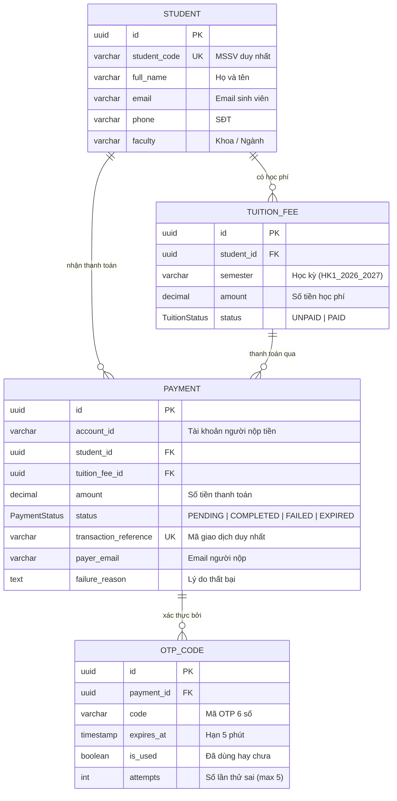

# Phân Hệ Thanh Toán Học Phí iBanking (TDTU) - TV2: Payment & Database

Dự án giữa kỳ môn **Kiến trúc hướng dịch vụ (SOA - CS504070)**.
Xây dựng hệ thống:  **Payment & Database**.

---

## 1. Phạm Vi Sở Hữu 

- **Database**:
  - Thiết kế và quản lý toàn bộ cơ sở dữ liệu: bảng `students`, `tuition_fees`, `payments`, `otp_codes`.
  - Cung cấp file DDL thuần PostgreSQL độc lập: [sql/schema.sql](sql/schema.sql).
  - Quản lý migration và schema qua Prisma ORM: [prisma/schema.prisma](prisma/schema.prisma).
  - Seed dữ liệu mẫu sinh viên TDTU: [prisma/seed.ts](prisma/seed.ts).
- **Student Service (Port 4001)**:
  - Tra cứu thông tin sinh viên theo MSSV (`GET /api/students/:studentCode`).
  - Tra cứu khoản học phí còn nợ của sinh viên (`GET /api/tuitions/student/:studentCode`).
- **Payment Service (Port 4002)**:
  - Tạo yêu cầu giao dịch trạng thái `PENDING` (`POST /api/payments/create-intent`).
  - Sinh mã OTP 6 số ngẫu nhiên: thời hạn 5 phút, không trùng với OTP còn hiệu lực của giao dịch khác, chỉ dùng thành công 1 lần, khóa sau 5 lần nhập sai.
  - Gửi mã OTP và email biên lai sau khi hoàn tất (qua [mailer.service.ts](src/payment-service/mailer/mailer.service.ts) hoặc webhook Notification Service của TV3).
  - Xác thực OTP và hoàn tất thanh toán (`POST /api/payments/confirm-otp`).
  - Tra cứu chi tiết giao dịch (`GET /api/payments/:id`) và lịch sử nộp tiền (`GET /api/payments/account/:accountId`).
- **Mock Account Service (Port 4003)**:
  - Giả lập Account Service của TV1 (Thành) để test trừ tiền (`POST /api/accounts/deduct`) và kiểm tra số dư (`GET /api/accounts/:id`).

---

## 2. Kiến Trúc Cổng & Dịch Vụ

```
[ Frontend: React - TV3 (Tài) ]  ───►  [ API Gateway - TV1 (Thành) ]
                                             │
      ┌──────────────────────────────────────┼──────────────────────────────────────┐
      ▼                                      ▼                                      ▼
[ Student Service ]                   [ Payment Service ]                 [ Account Service ]
  Port: 4001                            Port: 4002                          Port: 4003 (Mock)
  Swagger: /docs                        Swagger: /docs                      Owner: TV1 (Thành)
  Owner: TV2 (Phước)                    Owner: TV2 (Phước)
      │                                      │
      └──────────────────┬───────────────────┘
                         ▼
             [ PostgreSQL Container ]
               Host Port: 5433
               DB: ibanking_db
```

- **Swagger UI Trực Tiếp**:
  - Student Service: `http://localhost:4001/docs` (JSON: `http://localhost:4001/docs.json`)
  - Payment Service: `http://localhost:4002/docs` (JSON: `http://localhost:4002/docs.json`)

---

## 3. Sơ Đồ Cơ Sở Dữ Liệu (ERD)



> **Chốt chặn an toàn cấp Database**:
> `idx_unique_completed_payment_per_tuition` (`CREATE UNIQUE INDEX ON payments(tuition_fee_id) WHERE status = 'COMPLETED'`) đảm bảo tuyệt đối không có 2 bản ghi `COMPLETED` cho cùng 1 khoản học phí.

---

## 4. Hướng Dẫn Cài Đặt & Khởi Chạy

### Yêu cầu tiên quyết
- Node.js >= 20.x
- Docker Desktop đang bật

### Bước 1: Khởi động PostgreSQL Container
```bash
docker compose up -d
```
Container `ibanking-postgres` sẽ chạy tại `localhost:5433`, database `ibanking_db`.

### Bước 2: Cài đặt thư viện
```bash
npm install
```

### Bước 3: Đồng bộ Schema & Seed Dữ Liệu
```bash
# Đẩy schema Prisma vào PostgreSQL
npm run db:push

# Nạp dữ liệu mẫu sinh viên TDTU
npm run seed
```

**Dữ liệu mẫu đã seed:**
| MSSV | Họ và tên | Khoa | Học kỳ | Số tiền (VNĐ) | Trạng thái |
| :--- | :--- | :--- | :--- | :--- | :--- |
| `521H0001` | Nguyễn Văn An | CNTT | HK1_2026_2027 | 12.500.000 | `UNPAID` |
| `521H0002` | Trần Thị Bích | QTKD | HK1_2026_2027 | 10.800.000 | `UNPAID` |
| `521H0003` | Lê Hoàng Nam | TCNH | HK1_2026_2027 | 14.000.000 | `PAID` |
| `521H0004` | Phạm Minh Đức | KTPM | HK1_2026_2027 | 15.200.000 | `UNPAID` |
| `521H0005` | Đặng Thu Hà | NNA | HK1_2026_2027 | 9.500.000 | `UNPAID` |

### Bước 4: Khởi chạy các Service
```bash
# Chạy đồng loạt Student Service (4001), Payment Service (4002) và Mock Account (4003)
npm run dev
```

Hoặc chạy từng service độc lập:
```bash
npm run dev:student       # Port 4001
npm run dev:payment       # Port 4002
npm run dev:account-mock  # Port 4003
```

---

## 5. Danh Sách API Chi Tiết

### A. Student Service (`http://localhost:4001/api`)

#### 1. Tra cứu sinh viên theo MSSV
- **Endpoint**: `GET /students/:studentCode`
- **Ví dụ**: `GET /students/521H0001`
- **Response `200 OK`**:
```json
{
  "success": true,
  "data": {
    "id": "c1387d7b-232a-43d9-9594-8ef8152c1ef4",
    "studentCode": "521H0001",
    "fullName": "Nguyễn Văn An",
    "email": "521h0001@student.tdtu.edu.vn",
    "phone": "0901234567",
    "faculty": "Công nghệ thông tin"
  }
}
```

#### 2. Lấy thông tin khoản học phí cần nộp
- **Endpoint**: `GET /tuitions/student/:studentCode`
- **Ví dụ**: `GET /tuitions/student/521H0001`
- **Response `200 OK`**:
```json
{
  "success": true,
  "data": {
    "id": "936fc3ae-d261-4541-b883-fa349d4ceb4f",
    "studentId": "c1387d7b-232a-43d9-9594-8ef8152c1ef4",
    "studentCode": "521H0001",
    "studentName": "Nguyễn Văn An",
    "faculty": "Công nghệ thông tin",
    "semester": "HK1_2026_2027",
    "amount": 12500000,
    "status": "UNPAID"
  }
}
```

---

### B. Payment Service (`http://localhost:4002/api`)

#### 1. Tạo yêu cầu giao dịch thanh toán & Sinh OTP
- **Endpoint**: `POST /payments/create-intent`
- **Request Body**:
```json
{
  "accountId": "ACC-001",
  "studentCode": "521H0001",
  "tuitionFeeId": "936fc3ae-d261-4541-b883-fa349d4ceb4f",
  "payerEmail": "phu@tdtu.edu.vn"
}
```
- **Response `201 Created`**:
```json
{
  "success": true,
  "message": "Mã OTP đã được gửi tới phu@tdtu.edu.vn. Vui lòng xác nhận trong 5 phút.",
  "data": {
    "paymentId": "7c8e9b01-fa23-4df5-9112-abcdef123456",
    "transactionReference": "TXN-1794033675510-2232",
    "status": "PENDING",
    "amount": 12500000,
    "studentCode": "521H0001",
    "studentName": "Nguyễn Văn An",
    "payerEmail": "phu@tdtu.edu.vn",
    "expiresAt": "2026-11-07T07:46:15.510Z"
  }
}
```

#### 2. Xác thực OTP & Hoàn tất thanh toán
- **Endpoint**: `POST /payments/confirm-otp`
- **Request Body**:
```json
{
  "paymentId": "7c8e9b01-fa23-4df5-9112-abcdef123456",
  "otpCode": "948275"
}
```
- **Response `200 OK`**:
```json
{
  "success": true,
  "message": "Thanh toán học phí thành công",
  "data": {
    "paymentId": "7c8e9b01-fa23-4df5-9112-abcdef123456",
    "transactionReference": "TXN-1794033675510-2232",
    "status": "COMPLETED",
    "amount": 12500000,
    "studentCode": "521H0001",
    "studentName": "Nguyễn Văn An",
    "paidAt": "2026-11-07T07:41:20.123Z"
  }
}
```

#### 3. Lịch sử giao dịch của tài khoản
- **Endpoint**: `GET /payments/account/:accountId`
- **Ví dụ**: `GET /payments/account/ACC-001`

---

## 6. Hướng Dẫn Sử Dụng Postman Collection

File [postman_collection.json](postman_collection.json) đã được chuẩn bị sẵn ở thư mục gốc:
1. Mở Postman $\rightarrow$ Chọn **Import** $\rightarrow$ Kéo thả file `postman_collection.json`.
2. Chạy request `1.3 Lấy khoản học phí`: Script tự động gán biến `tuition_fee_id`.
3. Chạy request `2.1 Tạo yêu cầu thanh toán`: Script tự động gán biến `payment_id`.
4. Xem mã OTP được in ra tại console terminal của `payment-service` và nhập vào request `2.4 Xác thực OTP`.

---

## 7. Chiến Lược Concurrency, Transaction Boundary & Kiểm Thử Tự Động

### Chiến lược chống Race Condition & Đảm bảo Nhất quán
1. **Chống 2 người cùng đóng 1 MSSV**: Khóa dòng độc quyền `SELECT ... FOR UPDATE` trên bảng `tuition_fees` bên trong `prisma.$transaction`, kết hợp Partial Unique Index `idx_unique_completed_payment_per_tuition` ở cấp PostgreSQL.
2. **Chống 1 tài khoản gửi nhiều giao dịch vượt số dư (Double-spending)**: Tuần tự hóa các giao dịch của cùng một `account_id` bằng `pg_advisory_xact_lock(hashtext(account_id))` trước khi gọi trừ tiền.
3. **Chống Double-click / Dùng lại OTP đồng thời**: Cập nhật nguyên tử `otpCode.updateMany({ where: { id, isUsed: false }, data: { isUsed: true } })` + khóa dòng `payments ... FOR UPDATE`.
4. **Transaction Boundary & Rollback Bù Trừ (Compensation)**: Nếu trừ tiền bên Account Service thành công nhưng DB lỗi trước khi commit `PAID`, transaction PostgreSQL tự động rollback trạng thái học phí về `UNPAID` và Payment Service tự động gọi `POST /accounts/refund` hoàn trả 100% số dư. Email biên lai chỉ được gửi **sau khi** DB đã commit thành công.

### Chạy toàn bộ bộ kiểm thử
```bash
# Chạy trọn bộ tất cả bài test (Student + Payment/OTP + Swagger + 3 bài Concurrency/Rollback)
npm test

# Chỉ chạy bộ test Concurrency & Rollback (Duplicate MSSV + Double-spending + Compensation)
npm run test:concurrency
```


## Hướng dẫn TV1

Xem [Auth, Account và Gateway](docs/tv1.md) để chạy chế độ TV1, Swagger, Postman và test PostgreSQL. Xem [contract Payment–Account](docs/payment-account-contract.md) để tích hợp debit và hoàn tiền.

Xem [kết quả kiểm thử TV1](docs/tv1-test-report.md) để phân biệt kết quả trên Account PostgreSQL và bộ hồi quy dùng Mock Account.
