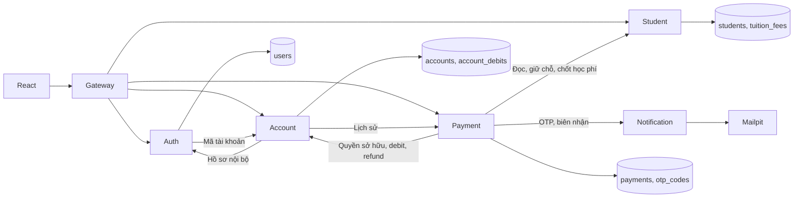

# iBanking · Thanh toán học phí TDTU

Frontend React gọi Gateway. Gateway xác thực JWT, chỉ chuyển tiếp các route công khai được khai báo và không có kết nối DB. Auth, Account, Student, Payment và Notification chạy riêng.



Bốn service dùng chung PostgreSQL server và schema, với bốn PostgreSQL role riêng. Mỗi role chỉ có quyền trên bảng service sở hữu. ID giữa service là tham chiếu theo API. Payment lưu bản chụp MSSV, tên và học kỳ để lịch sử không phụ thuộc dữ liệu sinh viên hiện hành.

## Demo mới trên Windows

1. Tạo file cấu hình riêng từ `.env.example`. Đặt mật khẩu PostgreSQL, `DEMO_PASSWORD` và các khóa JWT, Account, Auth, Student, OTP, Notification riêng, tối thiểu 32 byte mỗi khóa. Ví dụ tạo khóa bằng `node -e "console.log(require('node:crypto').randomBytes(32).toString('hex'))"`. Nếu đã có demo cũ, chọn project Compose, port và schema mới, ví dụ `micro_demo_v2`. Giữ các cấu hình cũ để truy cập dữ liệu trước đây.
2. Lưu cấu hình vào `.env.micro.local` rồi nạp biến vào PowerShell. `DATABASE_URL` là kết nối admin chỉ dùng để áp schema, tạo role và nạp dữ liệu mẫu.

   ```powershell
   Get-Content .env.micro.local | Where-Object { $_ -match '^[A-Z_][A-Z0-9_]*=' } | ForEach-Object {
     $name, $value = $_ -split '=', 2
     [Environment]::SetEnvironmentVariable($name, $value.Trim('"'), 'Process')
   }
   docker compose -p ibanking-v2 -f docker-compose.yml -f compose.integration.yml up -d --wait postgres mailpit notification
   npm ci
   npm run db:generate
   npm run db:push -- --skip-generate
   npm run db:account
   npm run db:recovery
   npm run db:roles
   npm run seed:account
   npm run seed:integration
   npm run build
   ```

3. Nạp bốn biến `*_DATABASE_URL` từ file local do `db:roles` tạo. Với Node chạy trên host, giữ URL PostgreSQL loopback. Khi dùng Compose cho cả backend, đổi hostname trong bốn URL thành `postgres`, cổng thành `5432`, rồi chạy Compose cùng file `compose.microservices.yml`. Gateway là tiến trình Node duy nhất được publish. Có thể dừng riêng một service bằng `docker compose ... stop payment` và bật lại bằng `docker compose ... start payment`.
4. Nếu chạy Node trên host, `npm run dev` khởi chạy năm tiến trình Node. Để chạy độc lập, đặt `DATABASE_URL` bằng URL role tương ứng cho từng terminal rồi dùng `npm run dev:auth`, `dev:account`, `dev:student`, `dev:payment` hoặc `dev:gateway`. Gateway không cần URL DB.
5. Cài frontend bằng `npm ci --prefix frontend`. Đặt `VITE_DEMO_MODE=false`, `VITE_API_CONTRACT_CONFIRMED=true` và `VITE_API_BASE_URL=http://localhost:4000/api` trong `frontend/.env`. Chạy `npm run dev:ui --prefix frontend`. Đăng nhập `demo1` với mật khẩu đã đặt lúc seed. Tra cứu `521H9001`, kiểm tra khoản 7 triệu, lấy OTP từ Mailpit và xem kết quả cùng lịch sử. Có thể dùng `521H9002` để thử giao dịch khác.
6. URL mặc định gồm [Web](http://localhost:5173), [Gateway health](http://localhost:4000/health), [Swagger Gateway](http://localhost:4000/docs/), [Mailpit](http://localhost:8025), Swagger [Auth](http://127.0.0.1:4004/docs/), [Account](http://127.0.0.1:4003/docs/), [Student](http://127.0.0.1:4001/docs/) và [Payment](http://127.0.0.1:4002/docs/) khi các service chạy trên host. Trong Compose, cổng Swagger nội bộ được giữ trong mạng container.

## Luồng ghi nhận thanh toán

- Payment dùng khóa idempotency theo tài khoản để trả cùng intent. Frontend gửi lại đúng ID học phí và số tiền đã hiển thị. OTP lưu HMAC, thời hạn năm phút, tiêu thụ cùng lúc ghi trạng thái `PROCESSING`.
- Student giữ chỗ khoản phí theo `paymentId` trước debit. Account kiểm tra và cập nhật số dư nguyên tử, lưu kết quả debit/refund theo cùng ID.
- Nếu mất phản hồi debit, Payment tiếp tục đối soát và yêu cầu lại với cùng ID. Khi Student đã xác nhận `PAID` cho ID đó, Payment mới ghi `COMPLETED`. Nếu cần bù trừ, `REFUND_PENDING` được lưu trước refund. Sau xác nhận refund và nhả giữ chỗ, Payment mới kết thúc thất bại.
- Mailpit nhận thư thử nghiệm. Payment cần cấu hình kênh email, trừ khi chọn rõ `MAIL_MODE=mock` cho test riêng. Biên nhận được gửi sau khi commit và có thể được gửi lại nếu mất xác nhận.

- Payment và bản ghi HMAC của OTP được tạo nguyên tử. Nếu tiến trình dừng trước khi gửi email, OTP hết hạn sau năm phút. Người dùng tạo yêu cầu mới với khóa mới. Worker kết thúc intent cũ thiếu OTP khi đã quá năm phút.
- Các lỗi HTTP trong quá trình đối soát được thử lại tối đa 30 lần với khoảng chờ tăng đến 60 giây. `REVIEW_REQUIRED` lưu bước lỗi và dừng retry tự động. Khi vận hành, dùng mã giao dịch để đối chiếu ledger Account và `reserved_payment_id`/trạng thái học phí tại Student. Nếu đã xác nhận Student ghi PAID cho đúng ID, khôi phục xử lý commit idempotent. Nếu cần hoàn tiền, xác minh Student chưa commit và đã chặn khả năng commit muộn trước khi chạy bù trừ với cùng ID. Nếu Student xác nhận khoản phí đã PAID cho một paymentId khác sau debit, Payment ghi REFUND_PENDING và tự bù trừ. Các trường hợp chưa xác định được kết quả commit được giữ để đối soát.
- Healthcheck container xác nhận tiến trình HTTP phản hồi. Phép thử đăng nhập và thanh toán xuyên service kiểm tra thêm kết nối DB, role và SMTP. Notification được build thành JAR và chạy trong image Java 17 riêng. `OTP_SECRET` phải có ít nhất 32 byte để Payment khởi động.

## Kiểm thử

Chạy `npm run build` và `npm run build --prefix frontend`. E2E cần PostgreSQL dùng schema tên `micro_test_*`, Notification và Mailpit. Đặt `MAILPIT_ORIGIN` nếu dùng cổng riêng. Chạy `npm run test:e2e`. Bộ test tạo dữ liệu thử mới và đọc OTP từ Mailpit. `npm test` chạy kiểm tra core. Đặt `RUN_CORE_DB_TESTS=1` cùng schema thử để kiểm tra PostgreSQL. `npm run test:processes` kiểm tra các tiến trình riêng và cần bốn URL role thử nghiệm. Các file test TV2 cũ được giữ làm tài liệu đối chiếu.

Không áp `db:push` lên schema demo cũ. Dữ liệu demo hiện tại có thể tiếp tục chạy trên phiên bản cũ. Chuyển lịch sử sang stack mới cần kế hoạch backfill bản chụp Payment và đối soát các giao dịch đang mở trước khi đổi đường truy cập.
