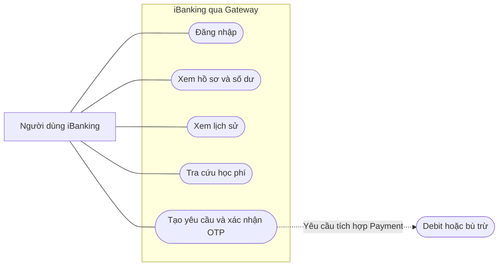
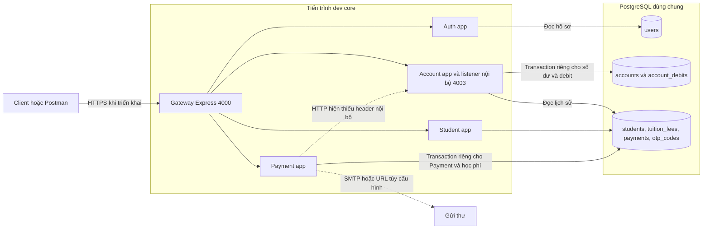

# TV1 · Auth, Account và Gateway

## Chạy demo

Yêu cầu Node.js 20 trở lên, npm và PostgreSQL 16. Các lệnh dưới đây chạy từ thư mục gốc repo bằng PowerShell.

1. Chạy `docker compose up -d --wait postgres`, `npm ci` và `Copy-Item .env.example .env` nếu chưa có `.env`.
2. Trong `.env`, đặt `DATABASE_URL` trỏ đến DB demo, đặt `JWT_SECRET` và `ACCOUNT_SERVICE_TOKEN` thành hai giá trị ngẫu nhiên riêng (tối thiểu 32 byte). Có thể chạy `node -e "console.log(require('node:crypto').randomBytes(32).toString('hex'))"` hai lần. Đặt `DEMO_PASSWORD` từ 12 ký tự. Đặt `DEMO_EMAIL` là hộp thư thử nghiệm nếu cần nhận OTP sau khi tích hợp Payment. Seed Account chỉ thêm dữ liệu thiếu.
3. Chạy lần lượt `npm run db:generate`, `npm run db:push`, `npm run db:account`, `npm run seed:account`. Bước `db:account` thêm CHECK vào PostgreSQL và có thể chạy lại. Trên DB demo mới, chạy `npm run seed` để có học phí. Lệnh seed TV2 xóa dữ liệu Student/Payment hiện tại, chỉ dùng trên DB demo riêng.
4. Chạy `npm run dev:core`. Gateway mặc định ở `http://127.0.0.1:4000`. Để giữ contract hiện có, Account nội bộ nghe loopback ở cổng 4003. Nếu đổi `PORT_ACCOUNT` thì đồng thời đổi `ACCOUNT_SERVICE_URL` gồm hậu tố `/api`.
5. Import [Postman TV1](tv1.postman_collection.json). Đặt `demoPassword` trong biến local của Postman, gửi **Đăng nhập** với `demo1`. Collection lưu JWT cho các request kế tiếp. Thử **Hồ sơ**, **Số dư**, **Lịch sử** và **Tra cứu sinh viên**. Thử sai username, sai mật khẩu và xóa Bearer, kết quả đều là 401.
6. Trên DB demo, đặt `serviceToken` cục bộ và tạo `paymentId` bằng `[guid]::NewGuid().ToString()`. Gửi **Debit hoặc retry** hai lần. Hai response trả cùng `remainingBalance`, số dư chỉ giảm một lần. Đổi amount với cùng UUID để nhận 409. Khôi phục amount ban đầu, gửi **Refund hoặc retry** hai lần để kiểm tra chỉ cộng tiền một lần. Debit thử qua API nội bộ chỉ tạo bản ghi Account. Lịch sử công khai đọc bảng Payment.
7. Mở Swagger Account tại `http://127.0.0.1:4003/docs/`. Chạy thêm `npm run dev:auth` và mở `http://127.0.0.1:4004/docs/` để thử Swagger Auth. Mỗi service có JSON tại `/docs.json`.

`npm run dev` tiếp tục phục vụ demo cũ với Mock Account. Chạy chế độ này và `dev:core` ở các thời điểm khác nhau vì cả hai mặc định dùng cổng 4003. Khi đưa Gateway lên mạng, chỉ công bố Gateway sau TLS. Giữ Account nội bộ, PostgreSQL và các entry point độc lập của TV2 trong mạng tin cậy. Nếu Payment còn thiếu xác thực nội bộ, yêu cầu tạo giao dịch qua Gateway sẽ bị từ chối khi tra cứu Account.

## Endpoint

| Endpoint qua Gateway | Quyền | Dữ liệu |
| --- | --- | --- |
| `GET /health` | Công khai | Trạng thái Gateway |
| `POST /api/auth/login` | Công khai | `{username,password}` → `data.accessToken, tokenType, expiresIn` |
| `GET /api/auth/me` | Bearer | `userId, username, fullName, email, phone, accountId` |
| `GET /api/accounts/me` | Bearer | Hồ sơ Account và số dư |
| `GET /api/accounts/me/balance` | Bearer | `accountId, balance` |
| `GET /api/accounts/me/transactions` | Bearer | Tối đa 100 bản ghi mới nhất của tài khoản trong bảng Payment |
| `GET /api/students/:studentCode`, `GET /api/tuitions/student/:studentCode` | Bearer | Đọc sinh viên và học phí để thanh toán |
| `POST /api/payments/create-intent` | Bearer | Gateway lấy `accountId` và `payerEmail` từ hồ sơ của JWT |
| `POST /api/payments/confirm-otp`, `GET /api/payments/:paymentId` | Bearer + sở hữu giao dịch | Contract OTP và giao dịch hiện có |
| `GET /api/payments/account/:accountId` | Bearer + sở hữu tài khoản | Contract lịch sử của Payment |

Gateway lọc các header `X-*` và `Forwarded`, rồi định tuyến theo allowlist. Endpoint ghi học phí trực tiếp của TV2 và debit/refund nội bộ nằm ngoài allowlist. Notification thuộc luồng gửi thư của Payment qua `NOTIFICATION_SERVICE_URL`; frontend chỉ giao tiếp Gateway.

## Cơ sở dữ liệu

- `users` có UUID, username duy nhất, họ tên, email, điện thoại và hash scrypt với salt riêng.
- `accounts` có mã tài khoản, khóa ngoại duy nhất đến user, số dư VND nguyên kiểu BIGINT và CHECK từ 0 đến 999.999.999.999.
- `account_debits` khóa chính `payment_id`, tham chiếu account, lưu số tiền và số dư ngay sau debit/refund. `remaining_balance = NULL` ở bản ghi đã commit biểu thị debit bị từ chối vì thiếu tiền. `refunded_balance` có giá trị khi đã bù trừ.
- Account và Payment dùng chung PostgreSQL nhưng commit riêng. Account chỉ đọc bảng Payment để trả lịch sử. Ba bảng TV1 có trong Prisma để `db:push` nhận diện. SQL bổ sung CHECK độc lập với các bảng TV2.

## Kiểm thử

```powershell
npm run build
npm run test:core
$env:RUN_CORE_DB_TESTS='1'
npm run test:core
Remove-Item Env:RUN_CORE_DB_TESTS
docker compose config -q
```

Chế độ DB cần PostgreSQL đã chạy `db:push` và `db:account`. Nên dùng schema thử riêng qua tham số `schema` trong `DATABASE_URL`. Bộ test tạo tài khoản riêng có số dư 10 triệu và dọn dữ liệu theo ID của chính test. Test rollback chèn lỗi sau UPDATE số dư và trước khi lưu kết quả debit. Chi tiết tích hợp xem [contract Payment](payment-account-contract.md).

## Use case iBanking



## Kiến trúc chế độ TV1


