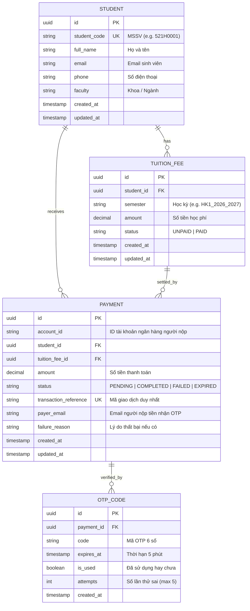

# Data Model: Student & Payment Services

**Branch**: `001-payment-student-service`  
**Date**: 2026-11-07  

---

## 1. Entity Relationship Diagram (Conceptual)



---

## 2. Prisma Schema Definition

```prisma
datasource db {
  provider = "postgresql"
  url      = env("DATABASE_URL")
}

generator client {
  provider = "prisma-client-js"
}

enum TuitionStatus {
  UNPAID
  PAID
}

enum PaymentStatus {
  PENDING
  COMPLETED
  FAILED
  EXPIRED
}

model Student {
  id          String       @id @default(uuid()) @db.Uuid
  studentCode String       @unique @map("student_code") @db.VarChar(20)
  fullName    String       @map("full_name") @db.VarChar(100)
  email       String       @db.VarChar(100)
  phone       String       @db.VarChar(20)
  faculty     String       @db.VarChar(100)
  createdAt   DateTime     @default(now()) @map("created_at")
  updatedAt   DateTime     @updatedAt @map("updated_at")

  tuitionFees TuitionFee[]
  payments    Payment[]

  @@map("students")
}

model TuitionFee {
  id        String        @id @default(uuid()) @db.Uuid
  studentId String        @map("student_id") @db.Uuid
  semester  String        @db.VarChar(50)
  amount    Decimal       @db.Decimal(12, 2)
  status    TuitionStatus @default(UNPAID)
  createdAt DateTime      @default(now()) @map("created_at")
  updatedAt DateTime      @updatedAt @map("updated_at")

  student  Student   @relation(fields: [studentId], references: [id])
  payments Payment[]

  @@index([studentId, status])
  @@map("tuition_fees")
}

model Payment {
  id                   String        @id @default(uuid()) @db.Uuid
  accountId            String        @map("account_id") @db.VarChar(50)
  studentId            String        @map("student_id") @db.Uuid
  tuitionFeeId         String        @map("tuition_fee_id") @db.Uuid
  amount               Decimal       @db.Decimal(12, 2)
  status               PaymentStatus @default(PENDING)
  transactionReference String        @unique @map("transaction_reference") @db.VarChar(50)
  payerEmail           String        @map("payer_email") @db.VarChar(100)
  failureReason        String?       @map("failure_reason") @db.Text
  createdAt            DateTime      @default(now()) @map("created_at")
  updatedAt            DateTime      @updatedAt @map("updated_at")

  student    Student    @relation(fields: [studentId], references: [id])
  tuitionFee TuitionFee @relation(fields: [tuitionFeeId], references: [id])
  otpCodes   OtpCode[]

  @@index([accountId])
  @@index([tuitionFeeId, status])
  @@map("payments")
}

model OtpCode {
  id        String   @id @default(uuid()) @db.Uuid
  paymentId String   @map("payment_id") @db.Uuid
  code      String   @db.VarChar(10)
  expiresAt DateTime @map("expires_at")
  isUsed    Boolean  @default(false) @map("is_used")
  attempts  Int      @default(0)
  createdAt DateTime @default(now()) @map("created_at")

  payment Payment @relation(fields: [paymentId], references: [id], onDelete: Cascade)

  @@index([paymentId, isUsed])
  @@map("otp_codes")
}
```

---

## 3. Payment State Machine

```
      [Khởi tạo Payment]
              │
              ▼
        ┌───────────┐
        │  PENDING  │ ◄─── Sinh OTP (Hạn 5 phút)
        └─────┬─────┘
              │
      ┌───────┴────────────────────────┐
      │                                │
[Nhập đúng OTP & DB Lock Ok]   [Quá 5 phút / Sai 5 lần / Hết tiền / Đã nộp]
      │                                │
      ▼                                ▼
┌───────────┐                    ┌───────────┐
│ COMPLETED │                    │  FAILED / │
└───────────┘                    │  EXPIRED  │
                                 └───────────┘
```

